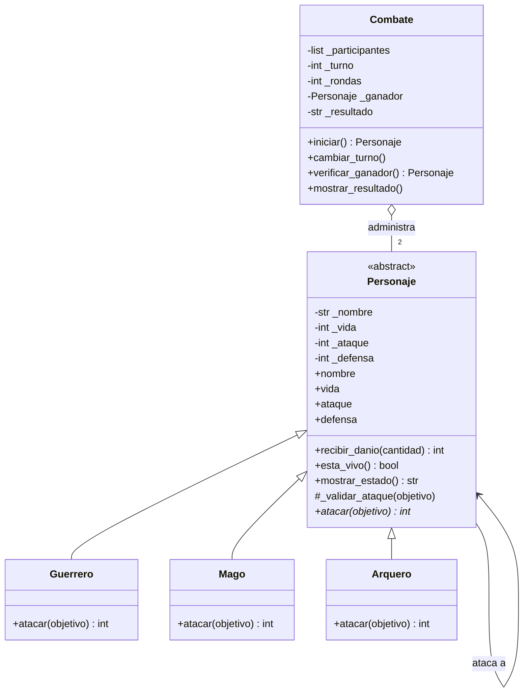

# Guardians of the Ancient Kingdom

**Autor:** Daniel Atencio · GitHub: [pete444hh](https://github.com/pete444hh)

Proyecto integrador de Programación Orientada a Objetos con Python: un sistema de combate por turnos entre guardianes del reino de Eldoria.

## 1. Descripción

El programa enfrenta a dos guardianes (Guerrero, Mago o Arquero) en un combate por turnos y decide solo quién gana. Cada guardián ataca a su manera, la vida nunca se sale de sus límites y los datos inválidos se rechazan con excepciones. El combate también detecta empates: si en una ronda completa nadie recibe daño (empate técnico) o si pasan 50 rondas sin ganador.

El problema que resuelve es organizar un sistema donde personajes distintos comparten características, pero se comportan diferente, sin repetir código y sin que el administrador del combate tenga que conocer los detalles de cada uno.

## 2. Estructura

```text
jueguito/
├── personajes.py        # las clases del sistema (no ejecuta nada al importarse)
├── main.py              # crea objetos, corre los casos de prueba y un combate completo
├── test_personajes.py   # pruebas automatizadas con pytest (reto extra 2)
└── README.md
```

- **`personajes.py`**: define `Personaje`, `Guerrero`, `Mago`, `Arquero` y `Combate`.
- **`main.py`**: importa las clases y comprueba los 12 casos obligatorios, mostrando `[OK]` o `[FALLO]` en cada uno.
- **`test_personajes.py`**: las mismas reglas, pero verificadas de forma automática con pytest.

## 3. Clases

| Clase | Responsabilidad |
|---|---|
| `Personaje` (abstracta) | Guarda nombre, vida, ataque y defensa con sus validaciones; sabe recibir daño, decir si está vivo y mostrar su estado. Obliga a las hijas a implementar `atacar()`. |
| `Guerrero` | Implementa `atacar()` con *Golpe poderoso*: ataque +20 % antes de restar la defensa. |
| `Mago` | Implementa `atacar()` con *Hechizo penetrante*: el daño es su ataque, sin restar defensa. |
| `Arquero` | Implementa `atacar()` con *Disparo crítico*: si su ataque supera la defensa, el daño base se duplica. |
| `Combate` | Controla los turnos, revisa si hay ganador, detecta los empates y muestra el resultado. No contiene lógica de daño. |

## 4. Relaciones

- **Herencia:** `Guerrero`, `Mago` y `Arquero` *son* un `Personaje`. Se usó para no repetir nombre, vida, ataque, defensa ni `recibir_danio()` en tres clases.
- **Asociación:** cuando un personaje ataca, interactúa con otro llamando a sus métodos (`objetivo.defensa`, `objetivo.recibir_danio(...)`). Ninguno es dueño del otro, solo se conocen durante el ataque.
- **Agregación:** un `Combate` *tiene* dos personajes, pero los personajes se crean fuera de él y siguen existiendo cuando el combate termina. Por eso `Combate` los recibe ya creados en el constructor.

## 5. Conceptos de POO en el programa

- **Abstracción:** `Personaje` hereda de `ABC` y declara `atacar()` con `@abstractmethod`. Define *qué* debe poder hacer un guardián sin decir *cómo*. Por eso `Personaje(...)` no se puede instanciar.
- **Encapsulamiento:** los atributos son privados (`_vida`, `_ataque`...) y solo se tocan mediante `@property` y setters que validan. Así es imposible tener vida 150, nombre vacío o ataque negativo, ni siquiera por accidente desde fuera de la clase.
- **Herencia:** las subclases reutilizan constructor, getters, setters, `recibir_danio()`, `esta_vivo()`, `mostrar_estado()` y `_validar_ataque()`. Solo escriben lo que las hace diferentes.
- **Polimorfismo:** en `Combate.iniciar()` se hace `atacante.atacar(objetivo)` sin preguntar si es Guerrero, Mago o Arquero. Cada objeto ejecuta su propia versión del método.

## 6. Lógica del combate

**Daño (todo con enteros):**

- Guerrero: `max(0, ataque * 120 // 100 - defensa_objetivo)`. Hice el 20 % con enteros porque `//` redondea hacia abajo y me evito errores de flotantes.
- Mago: `ataque`.
- Arquero: `(ataque - defensa_objetivo) * 2` si `ataque > defensa_objetivo`; si no, `0`.

Después, `recibir_danio()` descuenta `min(daño, vida_actual)`, así la vida nunca baja de cero y el método devuelve el daño efectivo (por eso en el turno 6 del ejemplo Gandalf pega 40 pero solo quita 20).

**Turnos:** una ronda son dos ataques, uno de cada participante. `cambiar_turno()` alterna el índice del atacante. Después de cada ataque se muestra el estado de ambos y se llama a `verificar_ganador()`. El combate termina cuando:

1. Alguien llega a 0 de vida → gana el otro.
2. Una ronda completa termina sin daño → empate técnico.
3. Se completan 50 rondas sin ganador → empate.

## 7. Ejecución

Necesitas Python 3.8 o superior.

```bash
git clone https://github.com/pete444hh/jueguito.git
cd jueguito
python main.py
```

Para las pruebas automatizadas:

```bash
pip install pytest
pytest -v
```

## 8. Pruebas

`python main.py` comprueba los 12 casos obligatorios. Resultado: **38 de 38 comprobaciones correctas**.

| # | Caso | Resultado |
|---|---|---|
| 1 | Creación de Guerrero, Mago y Arquero (y `Personaje` no instanciable) | OK |
| 2 | Vida 101 y -1 rechazadas | OK |
| 3 | Nombres vacíos rechazados | OK |
| 4 | Ataque 0 o negativo y defensa negativa rechazados | OK |
| 5 | Guerrero: 30 de ataque vs 10 de defensa = 26 | OK |
| 6 | Mago: 40 de daño contra 20 de defensa | OK |
| 7 | Arquero: 35 vs 15 = 40; y 0 si no supera la defensa | OK |
| 8 | 50 de daño sobre 20 de vida deja la vida en 0, no en -30 | OK |
| 9 | Un derrotado no puede atacar (ni ser atacado) | OK |
| 10 | Combate completo Arthas vs Gandalf | OK |
| 11 | Ganador: Gandalf con 2 de vida, en 3 rondas | OK |
| 12 | Dos arqueros que no se hacen daño: empate técnico | OK |

Además comprobé el empate por 50 rondas (dos magos de ataque 1, ambos terminan con 50 de vida).

## Reto 1: Diagrama de clases UML



**Cómo leerlo:** las flechas con triángulo vacío (`<|--`) son herencia: los tres guardianes extienden a `Personaje`, que es la clase abstracta (`<<abstract>>`) y tiene el método abstracto `atacar()` (marcado con `*`). La flecha simple de `Personaje` hacia sí misma es la asociación: un personaje ataca a otro. El rombo vacío (`o--`) es la agregación: `Combate` administra exactamente dos personajes, pero no los crea ni los destruye.

## Reto 2: Pruebas con Pytest

Pytest es una librería de Python para escribir pruebas automáticas. Cada función que empieza con `test_` es una prueba y se usa `assert` para afirmar lo que debe cumplirse; si algo falla, pytest dice cuál y por qué. A diferencia de revisar mensajes en pantalla a ojo, las pruebas se repiten en segundos cada vez que cambio el código.

Para ejecutarlas:

```bash
pip install pytest
pytest -v
```

Las pruebas (en `test_personajes.py`) cubren: creación válida, rechazo de valores incorrectos, daño de cada clase, vida nunca negativa, derrotado que no ataca y resultado de los combates (victoria, empate técnico y empate por 50 rondas).

Resultado de la ejecución:

```text
============================= test session starts ==============================
collected 36 items

test_personajes.py::test_creacion_valida[Guerrero] PASSED                [  2%]
test_personajes.py::test_creacion_valida[Mago] PASSED                    [  5%]
test_personajes.py::test_creacion_valida[Arquero] PASSED                 [  8%]
test_personajes.py::test_personaje_es_abstracta PASSED                   [ 11%]
...
test_personajes.py::test_combate_ejemplo_gana_gandalf PASSED             [ 83%]
test_personajes.py::test_combate_empate_tecnico PASSED                   [ 86%]
test_personajes.py::test_combate_empate_por_50_rondas PASSED             [ 88%]
...
============================== 36 passed in 0.42s ==============================
```

## Reto 3: Reto de abstracción

**¿Por qué `atacar()` debe ser abstracto, pero `recibir_danio()` puede estar implementado en la clase base?**

La clase `Personaje` representa lo que *todos* los guardianes son y lo que *todos* pueden hacer. Todos tienen nombre, vida, ataque y defensa, y todos reciben daño exactamente de la misma forma: se resta a la vida, sin pasar de cero. Eso lo hace `recibir_danio()`: valida que la cantidad no sea negativa, descuenta `min(cantidad, vida)` y devuelve el daño efectivo. Esa lógica no depende de si el personaje es Guerrero, Mago o Arquero, así que escribirla una sola vez en la base y heredarla evita repetirla tres veces y, sobre todo, evita que una de las copias tenga un error y permita vida negativa.

Con `atacar()` pasa lo contrario: lo único que comparten los guardianes es que *deben* poder atacar, pero *cómo* calculan el daño es justo lo que los diferencia. El Guerrero hace `ataque * 120 // 100 - defensa`, el Mago usa su ataque completo ignorando la defensa y el Arquero duplica `(ataque - defensa)` solo si lo supera. No existe una implementación general que sirva para los tres, entonces la clase base no puede dar un cuerpo razonable. Lo correcto es declararlo abstracto: así `Personaje` define el contrato ("todo guardián ataca") y obliga a cada hija a cumplirlo. Si alguien crea un `Curandero` y olvida `atacar()`, Python lo avisa con un `TypeError` al intentar instanciarlo.

Esto se conecta con los tres pilares:

- **Abstracción:** la base dice *qué* hace un guardián (atacar, recibir daño) y deja el *cómo* a quien corresponde.
- **Herencia:** lo que es igual para todos (`recibir_danio`, `esta_vivo`, validaciones, atributos) se hereda; lo que cambia se redefine.
- **Polimorfismo:** como `atacar()` existe en todas con la misma firma, `Combate` puede llamar `atacante.atacar(objetivo)` sin saber qué tipo es, y cada objeto responde a su manera. Además, el daño siempre se aplica por `objetivo.recibir_danio(...)`, que es común, así que las reglas de vida se cumplen sin importar quién ataque.

Gracias a esta decisión, agregar un guardián nuevo (por ejemplo un Paladín) solo requiere una clase que herede de `Personaje` e implemente `atacar()`; `Combate` no cambia ni una línea.
